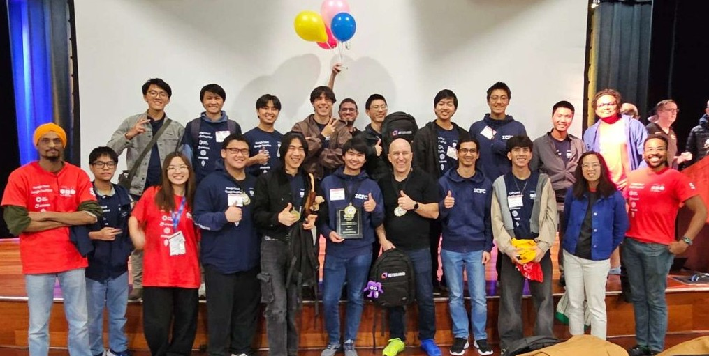
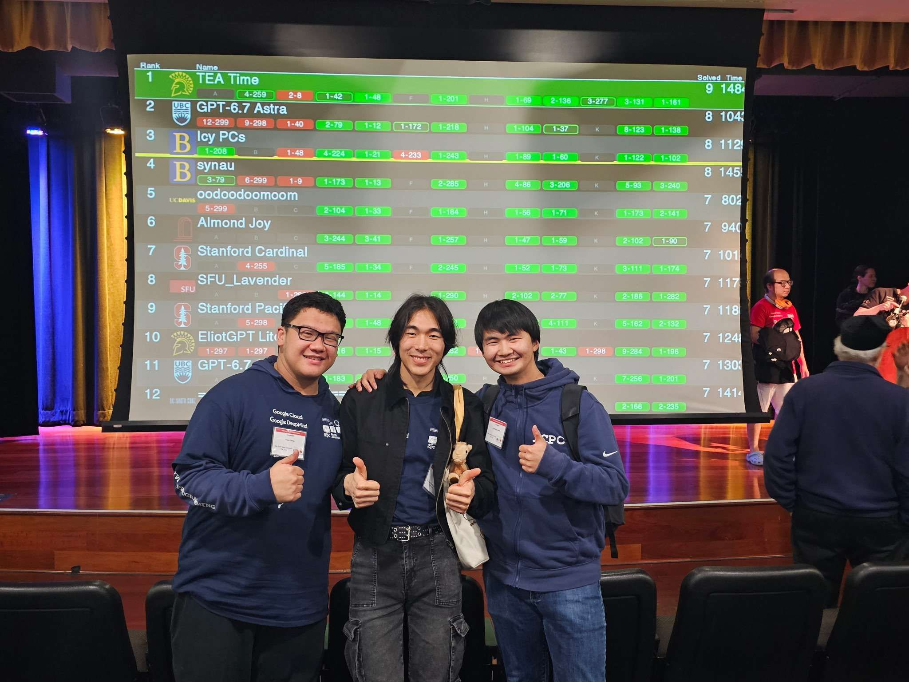
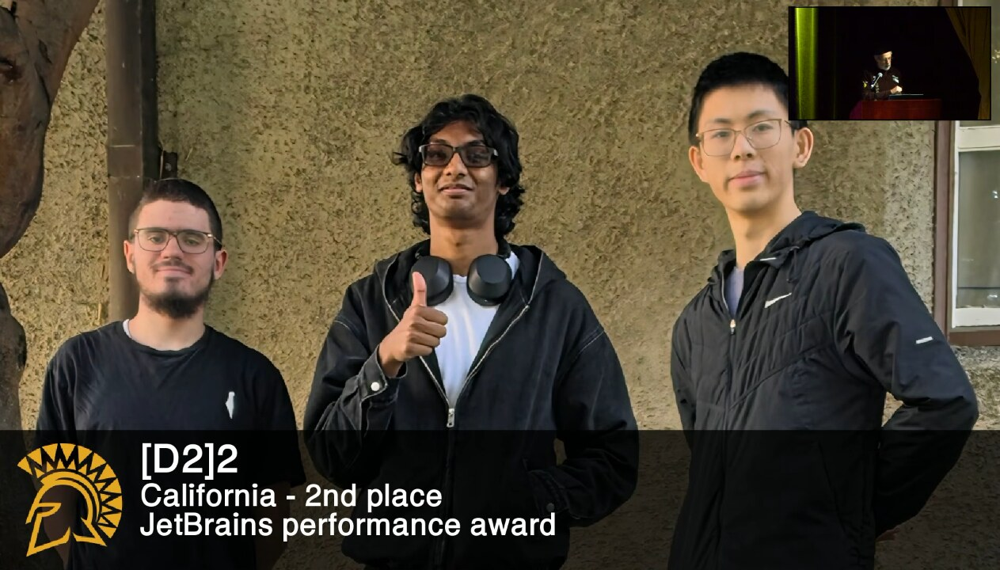

{: .team-photo}

we sent 8 teams to the 2026 ICPC Pacific Northwest regional programming competition, which SJSU hosted this year: 5 teams in division 1 and 3 teams in division 2.

we won the region this year! **TEA Time** took **1st place** out of 50 division 1 teams, solving 9 of the 13 problems. thank you **TEA Time**!

team trainers: Eliot Hall, Aarya Chamkeri, Noah Ruderman, Curtis Zhang, Amarjargal Ayurzana (Akiko)

## division 1 teams

### {: .team-photo} 1st/50 TEA Time (regional champions!)

<strong>Eliot Hall</strong>

<strong>Theon Olaivar</strong>

<strong>Amarjargal Ayurzana</strong>

### 10th/50 EliotGPT Lite

<strong>Curtis Zhang</strong>

<strong>Justin Lai</strong>

<strong>Noah Ruderman</strong>

### 24th/50 name?

<strong>Tyler Darisme</strong>

<strong>Kyle Lai</strong>

<strong>Isaac Fu</strong>

### 31st/50 whoami

<strong>Ching Yeung Kwok</strong>

<strong>Aidan Spies</strong>

### 36th/50 SJSU.Lil Sammy

<strong>Thuc Bao Tran</strong>

<strong>Conner Hsieh</strong>

<strong>Tung Ba Le</strong>

## division 2 teams

### {: .team-photo} 11th/74 [D2]2 (2nd place for California site)

<strong>Chahid Bagdouri</strong>

I'm Chahid, graduating with a B.S. in Computer Science in spring 2027. I enjoy competitive programming, math, and automation. I'm obsessed with understanding how things work, building useful things, and making a positive impact on my community.

LinkedIn: <a href="https://www.linkedin.com/in/chahid-bagdouri">https://www.linkedin.com/in/chahid-bagdouri</a> GitHub: <a href="https://github.com/ChahidBagdouri">https://github.com/ChahidBagdouri</a>

<strong>Isaiah Mak</strong>

3rd year Computer Science student, senior standing, specialization interest in theory (algorithms, math, constraint solving, optimization).

Hobbies: running, video games, piano (in my ever fleeting free time)

LinkedIn: <a href="https://www.linkedin.com/in/isaiah-mak/">https://www.linkedin.com/in/isaiah-mak/</a> GitHub: <a href="http://github.com/ShinyRayquay">http://github.com/ShinyRayquay</a>

<strong>Ru Bhavanasi</strong>

### 24th/74 [D2]0

<strong>David Nguyen</strong>

<strong>Andres Blanco</strong>

<strong>Darren Daniel</strong>

### 59th/74 pi

<strong>Miguel Velazquez</strong>

<strong>Valerie Hong</strong>

<strong>Aarav Ghai</strong>

