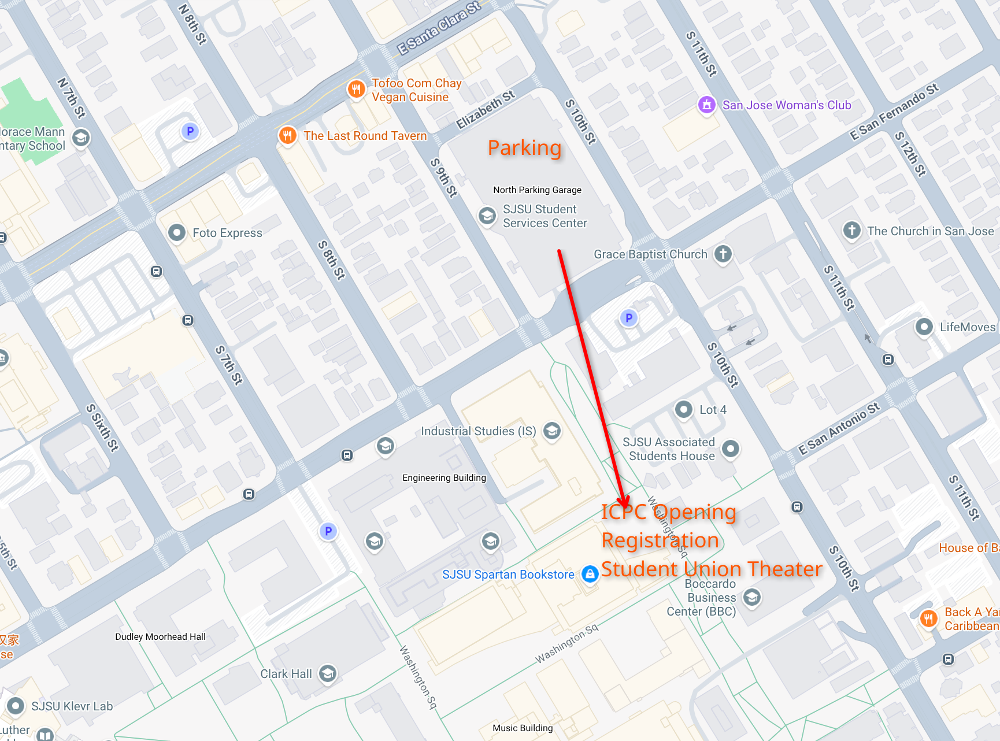

San Jose State University is hosting the California site of the 2026 Pacific Northwest Regional International Collegiate Programming Contest on November 16th, 2026.

## Parking

Unfortunately, you have to pay for parking at SJSU.
There are a few parking garages around the edges of campus, but the "10th Street North Parking Lot" is the closest to the contest location.
See the map below for the location of the garage and opening ceremonies.

## Schedule

* 10:30AM-11:30AM: Opening Ceremonies in **Student Union Theater**
* 11:30AM-12:30AM: Registration/checkin/Lunch **Theater Courtyard**
* 12:30AM-1PM: Move to contest location **Follow Volunteers**
* 1PM-6PM: Contest!
* 6PM-6:30PM: Pizza **Theater Courtyard**
* 6:30PM-7:30PM: Closing Ceremonies and Resolver **Student Union Theater**

## Coach Lounge

The coach lounge we be in ENG 285/7 during the contest.
SJSU WiFi has a guest network as well as **eduroam** for those from participating organizations.

## Map

